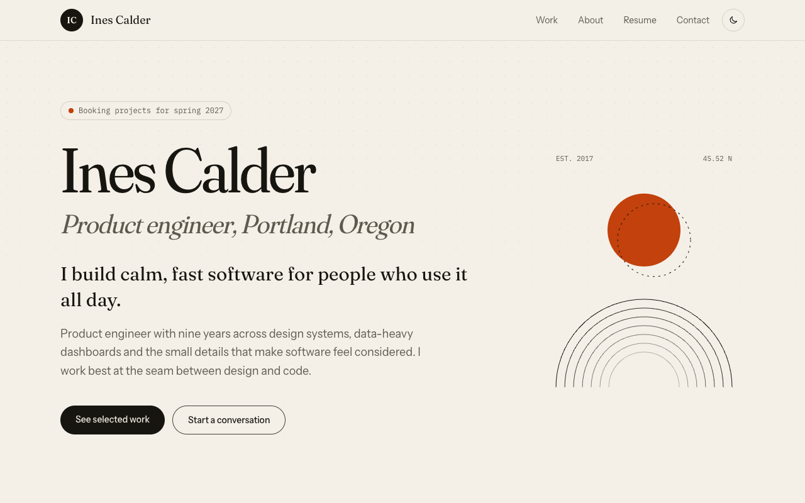

# Portfolio

A developer portfolio template with MDX case studies, a resume section, a contact form and dark mode, built as a fully static Next.js site.



[](https://console.cloudzyro.com/new?repo=https://github.com/Cloudzyro/template-portfolio)

## What's included

- Hero with your name, role, location and an availability badge
- Project grid with generated SVG cover art, each linking to a case study page written in MDX
- About section with quick facts
- Resume section: experience timeline, grouped skills, education and an optional "Download CV" button
- Contact form that posts to any form service, with an email fallback
- Light and dark mode with a toggle (remembers the choice, follows the device until one is made)
- SEO: page titles and descriptions, Open Graph and Twitter tags, a generated social image, `sitemap.xml`, `robots.txt` and a favicon
- Static output (`out/`), so it needs no server and never sleeps
- Responsive down to 360px, keyboard friendly, respects reduced motion

## Run it locally

```bash
pnpm install
pnpm dev        # http://localhost:3000
pnpm build      # static site in out/
pnpm preview    # serve out/ locally
```

## Make it yours

- **Text, projects, experience and skills:** `src/content/site.ts`. Everything on the home page comes from this one file.
- **Case studies:** one MDX file per project in `src/content/projects/`, named after the project's `slug` in `site.ts`. Write in Markdown; headings, lists, quotes and code blocks are already styled.
- **Project covers:** each project picks two gradient colors, an ink color and a pattern (`orbits`, `grid`, `waves` or `bars`) in `site.ts`. To use real screenshots, put images in `public/` and swap `ProjectCover` for an `` with alt text.
- **CV download:** put a PDF in `public/` and set `cvFile` (for example `"/ines-calder-cv.pdf"`) in `site.ts`. Leave it empty to hide the button.
- **Contact form:** set `NEXT_PUBLIC_FORM_ENDPOINT` to a form endpoint from Formspree, Basin, a Supabase function or similar (the form sends `name`, `email` and `message` as form data). With nothing set, the form shows a friendly note with your email address instead.
- **Site address:** set `NEXT_PUBLIC_SITE_URL` (or `url` in `site.ts`) so the sitemap, robots.txt and social previews use your domain.
- **Colors:** the palette is a handful of CSS variables at the top of `src/app/globals.css` (`--paper`, `--ink`, `--accent` and friends), with a dark set under `.dark`.
- **Fonts:** Fraunces, Instrument Sans and IBM Plex Mono, loaded with `next/font` in `src/app/layout.tsx`. Swap them there.
- **Social image:** `src/app/og.png/route.tsx` draws it from your name and headline at build time.

Copy `.env.example` to `.env.local` for local development.

## Deploy

Click the button above, or push your own copy to GitHub and connect it in the Cloudzyro console. Set `NEXT_PUBLIC_FORM_ENDPOINT` and `NEXT_PUBLIC_SITE_URL` as environment variables before building. The build output is the static `out/` folder.

## Stack

- Next.js 16 (App Router, `output: "export"`)
- React 19
- Tailwind CSS 4
- MDX via `@next/mdx`
- TypeScript

## License

MIT, see [LICENSE](./LICENSE).
